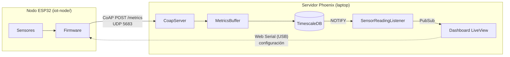

# LiveMetrics

Plataforma IoT para monitorear en tiempo real cualquier variable física: un cultivo, un acuario, una habitación, una bodega, un proceso de laboratorio o un banco de pruebas. Nodos ESP32 leen sensores y envían las mediciones por **CoAP** (UDP) a un servidor **Phoenix LiveView**, que las guarda en **TimescaleDB** y las muestra en vivo.

Cada **lectura** es un seguimiento con inicio y fin en un área, y se evalúa contra una **definición de lectura**: los rangos mínimo/máximo esperados por tipo de sensor.



## Contenido

- [Conceptos](#conceptos)
- [Requisitos](#requisitos)
- [Puesta en marcha del servidor](#puesta-en-marcha-del-servidor)
- [Firmware del nodo](#firmware-del-nodo)
- [Configuración del nodo por USB](#configuración-del-nodo-por-usb)
- [Drivers y calibración](#drivers-y-calibración)
- [Montajes de ejemplo](#montajes-de-ejemplo)
- [Protocolo CoAP](#protocolo-coap)
- [Solución de problemas](#solución-de-problemas)
- [Desarrollo](#desarrollo)

## Conceptos

| Concepto                  | Descripción                                                                                                                                                                     |
| ------------------------- | ------------------------------------------------------------------------------------------------------------------------------------------------------------------------------- |
| **Nodo**                  | Una ESP32. Se identifica por su MAC y se registra solo con la primera medición que llega.                                                                                       |
| **Sensor**                | Una entrada del nodo (`id` + `type`). También se registra automáticamente. Puede activarse o desactivarse desde **Devices**; las mediciones de sensores inactivos se descartan. |
| **Medición**              | Un valor enviado por un sensor en un instante.                                                                                                                                  |
| **Área**                  | Espacio físico donde se hacen lecturas (invernadero, bodega, acuario, laboratorio…).                                                                                            |
| **Definición de lectura** | Conjunto de rangos `min`–`max` por `sensor_type` (por ejemplo `temperature` entre 18 y 30). Se reutiliza en varias lecturas.                                                    |
| **Lectura**               | Seguimiento de una definición en un área durante un periodo, con nodos asociados cuyas mediciones se evalúan contra los rangos de la definición.                                |

> El `type` configurado en el sensor debe coincidir exactamente con el `sensor_type` de la definición de lectura (el servidor lo normaliza a minúsculas).
>
> En el código y la base de datos se conservan los nombres originales: las definiciones de lectura son `recipes` y las lecturas son `recipe_batch`.

## ¿Por qué referencias a recetas y lotes?

Un alcance previo del proyecto era el monitoreo en tiempo real de biopreparados de agricultura ecológica, sin embargo, el resultado final del producto llevó a un alcance más allá el esperado.

## Requisitos

**Servidor**

- Elixir 1.15+ con un Erlang/OTP compatible
- Docker y Docker Compose (para TimescaleDB)
- Navegador basado en Chromium (Chrome, Edge, Brave) para la configuración por Web Serial

**Nodo**

- Placa ESP32 DevKit (`esp32dev`)
- [PlatformIO](https://platformio.org/) (CLI o extensión de VS Code)
- Cable USB **de datos**

## Puesta en marcha del servidor

1. Crea el archivo `.env` en la raíz del proyecto:

   ```env
   DB_PASSWORD=secure-password
   DB_USER=root
   DB_NAME=metrics
   ```

2. Levanta la base de datos (los datos se persisten en `./data`):

   ```bash
   docker compose --env-file .env up -d
   ```

3. Instala dependencias, crea la base y ejecuta migraciones:

   ```bash
   mix setup
   ```

4. Inicia el servidor:

   ```bash
   mix phx.server
   # o con consola interactiva
   iex -S mix phx.server
   ```

   - Dashboard: [`http://localhost:4000`](http://localhost:4000)
   - Servidor CoAP: `udp://0.0.0.0:5683`

5. Abre el puerto CoAP en el firewall para que los nodos de la red lleguen a la laptop (ejemplo en Fedora):

   ```bash
   sudo firewall-cmd --add-port=5683/udp --permanent
   sudo firewall-cmd --reload
   ```

### Pantallas

| Ruta                | Uso                                                      |
| ------------------- | -------------------------------------------------------- |
| `/`                 | Dashboard: áreas y lecturas en curso                     |
| `/devices`          | Nodos registrados y sus sensores (activar/desactivar)    |
| `/devices/setup`    | Configuración de un nodo por USB (WiFi, CoAP y sensores) |
| `/recipes`          | Definiciones de lectura y sus rangos por tipo de sensor  |
| `/recipe-batch/:id` | Detalle de una lectura: gráficos en vivo por sensor      |

## Firmware del nodo

El firmware vive en [`iot-node/`](iot-node/) y está organizado por capas: `domain` (entidades), `usecases`, `infrastructure` (LittleFS/NVS, CoAP, NTP, sensores) y `presentation` (API serial).

```bash
cd iot-node
pio run -t upload        # compila y flashea
pio device monitor       # monitor serial a 115200 baudios
```

La configuración (WiFi, servidor CoAP y sensores) se guarda en la flash del nodo, así que sobrevive a reinicios y no hace falta recompilar para cambiarla.

## Configuración del nodo por USB

Desde **Devices → Configure via USB** (`/devices/setup`):

1. **Connect to device** y elige el puerto de la ESP32. La pantalla identifica el nodo por su MAC.
2. **WiFi**: SSID y contraseña de la red. Se envían directo desde el navegador; la contraseña no pasa por el servidor.
3. **CoAP server**: IP **local** de la laptop (`ip a`; no sirve `localhost`) y puerto `5683`.
4. **Sensors**: elige un preset o completa los campos y pulsa **Add and send to node**. El sensor se guarda en la base de datos (que le asigna el ID) y se envía al nodo.
5. Si el nodo ya estaba conectado a otra red, reinícialo (botón `EN`) para que use el nuevo WiFi. Los cambios de CoAP y de sensores se aplican sin reiniciar.

Cada sensor muestra si el nodo coincide con la base de datos: **Synced**, **Differs** o **Not on node**. **Send all to node** reenvía los que no coinciden y **Delete all** borra todos los sensores del nodo en ambos lados. La terminal muestra los comandos enviados (`->`) y las respuestas del nodo (`<-`).

> Requiere un firmware con el comando `info`. Si aparece "Could not identify the node: Unknown command", vuelve a flashear el nodo.

### API serial

Comandos JSON, uno por línea, a 115200 baudios:

```json
{"command":"ping"}
{"command":"wifi","data":{"action":"set","ssid":"MiRed","password":"secreto"}}
{"command":"wifi","data":{"action":"get"}}
{"command":"coap","data":{"action":"set","host":"192.168.1.50","port":5683}}
{"command":"coap","data":{"action":"get"}}
{"command":"sensor","data":{"action":"add","id":1,"pin":34,"type":"temperature","driver":"analog","precision":0.0806,"offset":0,"interval":10000}}
{"command":"sensor","data":{"action":"update","id":1,"pin":34,"type":"temperature","driver":"analog","precision":0.0806,"offset":-1.5,"interval":10000}}
{"command":"sensor","data":{"action":"remove","id":1}}
{"command":"sensor","data":{"action":"list"}}
```

| Campo       | Descripción                                                        | Por defecto |
| ----------- | ------------------------------------------------------------------ | ----------- |
| `id`        | Identificador del sensor dentro del nodo                           | requerido   |
| `pin`       | GPIO                                                               | requerido   |
| `type`      | Nombre de la variable; debe coincidir con la definición de lectura | `unknown`   |
| `driver`    | `analog`, `dht22_temp`, `dht22_hum`, `ds18b20`                     | `analog`    |
| `precision` | Factor multiplicador                                               | `1.0`       |
| `offset`    | Valor sumado tras multiplicar                                      | `0.0`       |
| `interval`  | Milisegundos entre mediciones                                      | `10000`     |

## Drivers y calibración

Cada medición se calcula como:

```
valor = valor_del_driver × precision + offset
```

| Driver       | Valor del driver                                                | Notas                                                                               |
| ------------ | --------------------------------------------------------------- | ----------------------------------------------------------------------------------- |
| `analog`     | ADC de 12 bits, `0`–`4095` (≈ 0–3.3 V), promedio de 10 muestras | Usar **solo pines ADC1**: 32, 33, 34, 35, 36, 39. ADC2 no funciona con WiFi activo. |
| `dht22_temp` | Temperatura en °C                                               | DHT22 / AM2302. Dos sensores pueden compartir el mismo pin (temperatura + humedad). |
| `dht22_hum`  | Humedad relativa en %                                           | Muestreo mínimo de 2 s.                                                             |
| `ds18b20`    | Temperatura en °C                                               | Bus 1-Wire, primer sensor del bus. Cada medición tarda ~750 ms.                     |

Si un sensor digital no responde (desconectado o mal cableado), el nodo no envía la medición y registra un aviso en el monitor serial.

**Calibrar dos puntos (sensores analógicos).** Mide el valor crudo en dos condiciones conocidas, `(raw₁, v₁)` y `(raw₂, v₂)`; para verla, pon temporalmente `precision = 1` y `offset = 0`. Luego:

```
precision = (v₂ − v₁) / (raw₂ − raw₁)
offset    = v₁ − raw₁ × precision
```

> ⚠️ Ningún GPIO de la ESP32 tolera más de **3.3 V**. Sensores con salida de 5 V requieren un divisor de voltaje.

## Montajes de ejemplo

Los presets de la pantalla de configuración corresponden a estos montajes. Son ejemplos: el sistema sirve para cualquier variable que un sensor pueda medir. Todos los componentes son comunes en tiendas de electrónica.

### 1. Planta en maceta (analógico)

Monitorea temperatura, luz y humedad del suelo de una planta.

**Materiales:** ESP32, protoboard, jumpers, LM35DZ, fotorresistencia LDR GL5528, resistencia de 10 kΩ, sensor capacitivo de humedad de suelo v1.2.

```
LM35 (cara plana al frente):  [+Vs]   [Vout]   [GND]
                                │        │        │
                             VIN (5V)  GPIO34    GND

LDR (divisor de voltaje):
  3V3 ── LDR ──┬── GPIO35
               └── 10kΩ ── GND

Humedad de suelo v1.2:  VCC → 3V3 | GND → GND | AOUT → GPIO32
```

| ID  | Pin | Type            | Driver | Precision | Offset | Interval |
| --- | --- | --------------- | ------ | --------- | ------ | -------- |
| 1   | 34  | `temperature`   | analog | 0.0806    | 0      | 10000    |
| 2   | 35  | `light`         | analog | 0.02442   | 0      | 10000    |
| 3   | 32  | `soil_moisture` | analog | -0.058824 | 176.47 | 30000    |

- El LM35 se alimenta con 5 V, pero su salida (10 mV/°C) no supera 1.5 V, así que es segura para el GPIO. Ajusta el `offset` comparando con un termómetro.
- `light` va de 0 (oscuro) a 100 (luz plena); es una medida relativa, no lux.
- `soil_moisture` asume 3000 crudo en seco (0 %) y 1300 sumergido en agua (100 %). Recalibra con tu sensor (ver [calibración](#drivers-y-calibración)).

**Definición sugerida — "Albahaca":** `temperature` 18–30 · `light` 30–90 · `soil_moisture` 40–80.

### 2. Ambiente de habitación o invernadero (DHT22 + luz)

Controla el clima del aire de un espacio cerrado.

**Materiales:** ESP32, módulo DHT22 (3 pines, con pull-up incluido), LDR GL5528 y resistencia de 10 kΩ.

```
DHT22 (módulo):  + → 3V3 | out → GPIO27 | - → GND
  (sensor suelto de 4 pines: añadir 10kΩ entre DATA y 3V3)

LDR:  3V3 ── LDR ──┬── GPIO35
                   └── 10kΩ ── GND
```

| ID  | Pin | Type              | Driver     | Precision | Offset | Interval |
| --- | --- | ----------------- | ---------- | --------- | ------ | -------- |
| 1   | 27  | `air_temperature` | dht22_temp | 1.0       | 0      | 10000    |
| 2   | 27  | `air_humidity`    | dht22_hum  | 1.0       | 0      | 10000    |
| 3   | 35  | `light`           | analog     | 0.02442   | 0      | 10000    |

**Definiciones sugeridas:**

- "Confort de oficina": `air_temperature` 20–26 · `air_humidity` 40–60.
- "Germinación": `air_temperature` 22–28 · `air_humidity` 70–90 · `light` 20–70.

### 3. Acuario o recipiente con agua (DS18B20)

Mide la temperatura del agua con una sonda sumergible.

**Materiales:** ESP32, DS18B20 versión sumergible (cable con punta de acero), resistencia de 4.7 kΩ.

```
DS18B20:  Rojo → 3V3 | Amarillo (DQ) → GPIO26 | Negro → GND
          4.7kΩ entre DQ y 3V3 (obligatoria)
```

| ID  | Pin | Type                | Driver  | Precision | Offset | Interval |
| --- | --- | ------------------- | ------- | --------- | ------ | -------- |
| 1   | 26  | `water_temperature` | ds18b20 | 1.0       | 0      | 10000    |

Se puede combinar con el DHT22 del montaje 2 en el mismo nodo para medir agua y aire a la vez.

**Definición sugerida — "Acuario tropical":** `water_temperature` 24–28.

### 4. Banco de pruebas (potenciómetro)

Simula una variable sin depender del entorno; útil para demos y para probar alertas fuera de rango.

**Materiales:** ESP32, potenciómetro de 10 kΩ.

```
Potenciómetro:  extremo A → 3V3 | centro → GPIO33 | extremo B → GND
```

| ID  | Pin | Type        | Driver | Precision | Offset | Interval |
| --- | --- | ----------- | ------ | --------- | ------ | -------- |
| 1   | 33  | `simulated` | analog | 0.02442   | 0      | 5000     |

Con `precision = 0.02442` la perilla recorre 0–100. **Definición sugerida — "Prueba":** `simulated` 30–70; gira la perilla a los extremos para salir del rango.

### Pines recomendados

| Uso                      | Pines                                             |
| ------------------------ | ------------------------------------------------- |
| Analógico (ADC1)         | 32, 33, 34, 35, 36 (VP), 39 (VN)                  |
| Digital (DHT22, DS18B20) | 4, 13, 14, 16, 17, 18, 19, 21, 22, 23, 25, 26, 27 |
| Evitar                   | 0, 2, 5, 12, 15 (arranque), 6–11 (flash interna)  |

## Protocolo CoAP

Los nodos envían `POST coap://<servidor>:5683/metrics` (mensaje confirmable, `application/json`):

```json
{ "m": "24:6F:28:AA:BB:CC", "s": 1, "t": "temperature", "p": 0.0806, "v": 25.1 }
```

| Clave | Significado              |
| ----- | ------------------------ |
| `m`   | MAC del nodo             |
| `s`   | ID del sensor en el nodo |
| `t`   | Tipo de sensor           |
| `p`   | Precisión configurada    |
| `v`   | Valor ya calibrado       |

El servidor agrupa las mediciones en `MetricsBuffer` (grupos de 10 o cada segundo) y las inserta en TimescaleDB; nodos y sensores nuevos se crean en la misma inserción.

## Solución de problemas

| Síntoma                                    | Causa probable                                                                                                                                    |
| ------------------------------------------ | ------------------------------------------------------------------------------------------------------------------------------------------------- |
| El nodo no aparece en **Devices**          | Firewall bloqueando UDP 5683, IP de CoAP incorrecta o nodo y laptop en redes distintas. Revisa `pio device monitor`.                              |
| Mediciones analógicas en 0 o fijas en 4095 | Pin ADC2 en uso con WiFi, cable suelto, o voltaje fuera de 0–3.3 V.                                                                               |
| `returned no valid reading`                | DHT22/DS18B20 mal cableado o sin resistencia pull-up.                                                                                             |
| **Connect to Device** no lista puertos     | Navegador sin Web Serial (usa Chromium), cable USB solo de carga, o falta de permisos sobre `/dev/ttyUSB*` (añade tu usuario al grupo `dialout`). |
| Mediciones no evaluadas en la lectura      | El `type` del sensor no coincide con el `sensor_type` de la definición de lectura, o el sensor está inactivo.                                     |

## Desarrollo

```bash
mix test                     # tests del servidor (requiere la base de datos levantada)
mix precommit                # compilación estricta, formato y tests

cd iot-node
pio test                     # tests del firmware (requiere la ESP32 conectada)
```

## Licencia

Ver [LICENSE](LICENSE).
